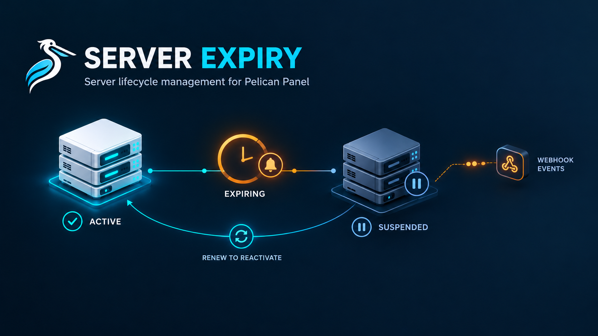

<div align="center">

[](https://github.com/3bdulrahmanOthman/server-expiry/releases)
[](LICENSE)


</div>

**Latest release:** [v2.2.1](https://github.com/3bdulrahmanOthman/server-expiry/releases/tag/v2.2.1) · [download the release ZIP](https://github.com/3bdulrahmanOthman/server-expiry/releases/download/v2.2.1/server-expiry-v2.2.1.zip)

**Server Expiry gives every Pelican Panel server a lifecycle.** Set an expiry
date, warn owners before it lapses, grant a grace period, suspend automatically
when it runs out — and bring the server back the moment it is renewed. Signed
webhook events and an Application API let you connect the lifecycle to billing,
provisioning or any other system.

It is built for providers: expiration is managed by administrators only, every
action is visible in the admin panel, and expiration suspensions never touch
servers that were suspended manually.

---

## Contents

- [Features](#features)
- [Requirements](#requirements)
- [Installation](#installation)
- [Quick start](#quick-start)
- [Configuration](#configuration)
- [Webhooks](#webhooks)
- [Application API](#application-api)
- [Commands and scheduling](#commands-and-scheduling)
- [Upgrade](#upgrade)
- [Troubleshooting](#troubleshooting)
- [Security notes](#security-notes)
- [Development](#development)
- [Further reading](#further-reading)

## Features

**Expiration management**

- An expiration date per server, managed from the admin panel: an **Expires At**
  column with status badges in the server list, row and bulk actions, an
  **Expiration** tab on *Edit Server*, and an optional step in the server
  creation wizard. A blank date means the server is permanent.
- A read-only **Expiration** page in the client panel showing status, date, time
  remaining, the configured warning thresholds and the suspension policy.
- An optional **Contact Support** call to action on that page, driven by
  `SERVER_EXPIRY_SUPPORT_URL`. It is hidden when the setting is empty or is not
  an HTTP(S) URL.

**Lifecycle automation**

- **Warnings** at configurable thresholds (default 7, 3 and 1 day before
  expiry). Each threshold is delivered to the owner once per server, by mail
  and as an in-panel notification.
- **Grace period** — a configurable number of hours after expiry during which
  the server keeps running.
- **Automatic suspension** after expiry plus grace, performed through Pelican's
  own `SuspensionService` (the server is marked suspended and Wings is told to
  re-sync), with the suspension reason stamped as `expiration`.
- **Automatic revival** when an administrator sets a future expiration date on
  a server that was suspended by expiry. Servers suspended manually are never
  revived by the plugin.

**Integrations**

- **Webhooks** with HMAC-SHA256 signatures, per-endpoint event subscriptions,
  delivery tracking, automatic retries with exponential backoff, and recovery of
  deliveries whose worker died mid-attempt. Delivery is **at-least-once** —
  receivers should deduplicate using the `X-Webhook-Delivery-ID` header.
- **Application API** under `/api/application/servers/{server}` to read, set,
  extend, renew and clear expiration, using the panel's standard Application API
  authentication and ACL.
- **Settings page** in *Admin Area → Plugins* for the lifecycle and webhook
  tuning options, stored in the panel `.env`.

## Requirements

| Requirement | Version / notes |
| --- | --- |
| [Pelican Panel](https://pelican.dev/) | **v1.0.0-beta38** or newer. `plugin.json` declares `^1.0.0-beta38`; development and verification were done against v1.0.0-beta38 (Filament 5). |
| PHP | **8.3+** (`composer.json` requires `^8.3`, matching the panel). |
| Database | MySQL/MariaDB, as required by Pelican Panel itself. |
| Scheduler | The panel's standard cron entry (`php artisan schedule:run` every minute). |

## Installation

**From the admin panel (recommended)**

1. Go to *Admin Area → Plugins*.
2. Use **Import from file** to upload the release ZIP, or **Import from URL** to
   import it from a direct link.
3. Click **Install** on the new plugin row. Migrations are applied
   automatically and the plugin is enabled.

**Manually**

1. Copy the plugin folder to `<panel>/plugins/server-expiry/`. The folder name
   must match the `id` in `plugin.json`.
2. Run `php artisan p:plugin:install server-expiry`, or open
   *Admin Area → Plugins* and click **Install**.
3. Confirm the scheduler is running (see below). No additional cron entry is
   needed: the plugin registers its commands with Laravel's scheduler.

```cron
* * * * * php /var/www/pelican/artisan schedule:run >> /dev/null 2>&1
```

After installation, reload the panel. The *Admin Area → Plugins → Settings*
dialog exposes all lifecycle options, and the admin sidebar gains a
**Server Expiry** group with **Webhook Endpoints** and **Deliveries**.

## Quick start

1. Open *Admin Area → Servers → (server)* and switch to the **Expiration** tab,
   or use the expiration actions on the server list.
2. Pick a date and time and save. Leaving the field empty makes the server
   permanent again.
3. The scheduler picks the server up within a minute: warnings are sent at the
   configured thresholds, and the server is suspended once expiry plus the
   grace period has passed.
4. To renew, set a new future date. If the server was suspended by expiry it is
   revived automatically and its warning thresholds reset.

Owner-facing notifications and the client **Expiration** page use the same
source of truth as the admin panel: the server's `expires_at` value.

## Configuration

Every option can be set in the panel `.env` or through the plugin settings
dialog (*Admin Area → Plugins → Settings*), which writes these keys to `.env`.

| Setting | Environment variable | Default | Description |
| --- | --- | --- | --- |
| Auto-suspend | `SERVER_EXPIRY_AUTO_SUSPEND` | `true` | Master switch for the whole lifecycle pass. When `false`, the scheduler does not warn or suspend. |
| Grace period | `SERVER_EXPIRY_GRACE_HOURS` | `0` | Hours after expiry before suspension. |
| Warning days | `SERVER_EXPIRY_WARNING_DAYS` | `7,3,1` | Comma-separated thresholds, in days before expiry. |
| Notify on suspend | `SERVER_EXPIRY_NOTIFY_ON_SUSPEND` | `true` | Send a mail and in-panel notification when a server is suspended for expiry. |
| Webhook attempts | `SERVER_EXPIRY_WEBHOOK_MAX_ATTEMPTS` | `3` | Maximum HTTP sends per webhook delivery, including the initial send (1–10 in the settings form). |
| Webhook timeout | `SERVER_EXPIRY_WEBHOOK_TIMEOUT` | `10` | HTTP timeout per webhook request, in seconds. Enforced range **1–60**; the settings form caps the field at 60. |
| Webhook backoff | `SERVER_EXPIRY_WEBHOOK_BACKOFF_BASE` | `1` | Base delay for the exponential retry backoff, in seconds (1–3600 in the settings form). |
| Support URL | `SERVER_EXPIRY_SUPPORT_URL` | *(empty)* | Optional support/renewal link on the owner page. Only HTTP(S) URLs are accepted; anything else hides the action. |

```dotenv
SERVER_EXPIRY_AUTO_SUSPEND=true
SERVER_EXPIRY_GRACE_HOURS=0
SERVER_EXPIRY_WARNING_DAYS=7,3,1
SERVER_EXPIRY_NOTIFY_ON_SUSPEND=true
SERVER_EXPIRY_WEBHOOK_MAX_ATTEMPTS=3
SERVER_EXPIRY_WEBHOOK_TIMEOUT=10
SERVER_EXPIRY_WEBHOOK_BACKOFF_BASE=1
SERVER_EXPIRY_SUPPORT_URL=
```

Values are normalized defensively: unusable numbers fall back to a safe minimum
(attempts, timeout and backoff are never below 1; the grace period is never
negative), and invalid warning thresholds are dropped instead of crashing the
scheduler.

## Webhooks

Manage endpoints in *Admin Area → Server Expiry → Webhook Endpoints* and inspect
deliveries in **Deliveries**. Each endpoint subscribes to any subset of these
events:

`server.expiry.created`, `server.expiry.updated`, `server.expiry.cleared`,
`server.expiry.warning`, `server.expiry.expired`, `server.expiry.suspended`,
`server.expiry.renewed`

### Request format

Deliveries are `POST` requests with a JSON body and these headers:

| Header | Value |
| --- | --- |
| `Content-Type` | `application/json` |
| `X-Signature` | `HMAC-SHA256(<raw body><X-Timestamp>, <endpoint secret>)`, lowercase hex |
| `X-Timestamp` | Unix timestamp generated when the request is signed |
| `X-Webhook-ID` | The endpoint's numeric ID |
| `X-Webhook-Delivery-ID` | Stable identifier of this delivery; identical on every retry |
| `User-Agent` | `Pelican-Server-Expiry/2.0` |

Verify the signature against the **raw** request body concatenated with
`X-Timestamp`, using the endpoint secret, and compare in constant time.

A random secret is generated when an endpoint is created without one. Editing
an endpoint never changes an existing secret. Endpoints created before v2.1.0
without a secret keep sending unsigned deliveries until you set one.

### Retries and delivery guarantees

- Each delivery is attempted at most `SERVER_EXPIRY_WEBHOOK_MAX_ATTEMPTS` times,
  **including the first send**.
- Failed attempts are retried by the scheduler every minute with exponential
  backoff: `base × 2^(attempt-1)` seconds (1 s, 2 s, 4 s, … with the default
  base).
- A worker claims a delivery with an atomic lease before sending. If the process
  dies mid-request, the lease expires after five minutes and the delivery is
  picked up again — or, if it had already used its final attempt, it is closed
  out as failed with the endpoint's failure counter updated exactly once.
- Delivery is **at-least-once**: a crash between the remote accepting a request
  and the panel recording the result can cause the same delivery to be sent
  again. Deduplicate on `X-Webhook-Delivery-ID`.
- Failed deliveries can also be retried manually from the Deliveries table.

The initial attempt happens synchronously when the event fires, so an
unreachable endpoint can add up to the configured timeout (60 s maximum) to the
request that triggered it. Retries run in the background scheduler.

Endpoint URLs are validated when saved: URLs pointing at private, reserved or
link-local addresses are rejected (SSRF protection). DNS rebinding between the
save-time check and delivery is not mitigated; point webhooks at hosts you
control.

## Application API

The plugin adds five endpoints under `/api/application/servers/{server}`,
authenticated with the panel's Application API (root-admin API keys) and
authorized through the panel's `server` resource ACL:

| Method | Path | ACL | Description |
| --- | --- | --- | --- |
| `GET` | `/expiration` | `READ` | Current status, expiration date, grace/expired flags and remaining seconds |
| `PUT` | `/expiration` | `WRITE` | Set `expires_at`, or make the server permanent with `{"permanent": true}` |
| `POST` | `/expiration/extend` | `WRITE` | Extend by `{"hours": N}` (422 for a permanent server) |
| `POST` | `/renew` | `WRITE` | Renew to a new `expires_at` |
| `DELETE` | `/expiration` | `WRITE` | Clear the expiration (make permanent) |

`status` in responses is the domain enum: `0` permanent, `1` active,
`2` warning, `3` expired, `4` grace, `5` suspended.

## Commands and scheduling

Both commands are registered with Laravel's scheduler and run every minute with
`withoutOverlapping`; they can also be run manually.

| Command | Schedule | Purpose |
| --- | --- | --- |
| `pelican:process-server-expiration` | every minute | Send due warnings and suspend servers past expiry + grace. Supports `--grace-hours=N` to override the configured grace period for one run. |
| `pelican:process-webhook-deliveries` | every minute | Retry due webhook deliveries and finalize deliveries whose worker died holding the last attempt. |

The individual `pelican:send-expiry-warnings` and
`pelican:suspend-expired-servers` commands remain available for manual use;
the consolidated command is what the scheduler runs.

## Upgrade

### v2.1.x → v2.2.1

- This is the first published release of the v2.2 line and includes the
  Application API request inheritance fixes.
  PR #10 adds `rules(): array` to all five Application API request classes and
  verifies the inherited contract against the real Pelican beta38 parent. Its
  regression coverage includes a source-level declaration guard, a runtime
  harness, and negative-control fixtures; the PR reports 305 tests / 1,006
  assertions across PHP 8.3, 8.4 and 8.5.
- Download: [release notes](https://github.com/3bdulrahmanOthman/server-expiry/releases/tag/v2.2.1)
  · [server-expiry-v2.2.1.zip](https://github.com/3bdulrahmanOthman/server-expiry/releases/download/v2.2.1/server-expiry-v2.2.1.zip).
- Install the new release over the existing `plugins/server-expiry/` folder and
  run the panel's plugin update, or use the **Update** action in
  *Admin Area → Plugins*.
- Migration `009_add_claim_to_webhook_deliveries_table` runs automatically. It
  adds two nullable columns (`claim_token`, `claimed_at`) and an index to
  `webhook_deliveries`; no existing row is rewritten and no data is discarded.
- Deliveries created before the upgrade keep their history. Rows left over from
  a previous crash are not rewritten, and no delivery is re-sent by the upgrade.
- Webhook receivers are unaffected: the payload format, request method and
  existing headers are unchanged. `X-Webhook-Delivery-ID` is an additional
  header.

### Earlier upgrades

- **v2.0.x → v2.1.0** — webhook admin URLs moved under
  `/admin/server-expiry/…`; no migrations. See
  [CHANGELOG.md](CHANGELOG.md).
- **v1.2.0 → v2.0.0** — migrations `003`–`008` and the new tables/columns. See
  [CHANGELOG.md](CHANGELOG.md).

> **Uninstalling rolls back the plugin migrations.** That drops the plugin's
> tables and columns, including `servers.expires_at` — expiration data is
> deleted. Back up before uninstalling.

## Troubleshooting

**No warnings or suspensions are sent.** Confirm the panel cron entry is
running (`php artisan schedule:list` should show the two `pelican:` commands),
and that `SERVER_EXPIRY_AUTO_SUSPEND` is not `false`.

**A webhook delivery is failing.** Open *Server Expiry → Deliveries* and check
the recorded HTTP status and error message. Common causes: the endpoint is not
subscribed to the event, the URL is not reachable over HTTPS, the response takes
longer than the configured timeout, or the URL was rejected as a private
address. Deliveries retry automatically while attempts remain, and can be
retried manually.

**A delivery shows “Processing” for a long time.** Another worker holds the
claim lease. If that worker died, the lease expires after five minutes: the
delivery is retried if it has attempts left, or closed out as failed if it does
not.

**The Contact Support button is missing.** `SERVER_EXPIRY_SUPPORT_URL` must be
an absolute `http://` or `https://` URL. Any other scheme is rejected and the
action is hidden.

## Security notes

- Webhook payloads are signed with HMAC-SHA256 over the raw body and timestamp;
  secrets are never written to the log.
- Endpoint URLs are checked against private, reserved and link-local ranges at
  save time.
- Expiration changes are administrator-only. The client page is read-only and
  performs no state changes.
- Webhook delivery is at-least-once by design; use `X-Webhook-Delivery-ID` for
  idempotent processing on the receiver side.

## Development

The plugin requires PHP 8.3+ and a Pelican Panel checkout for integration tests.

```bash
composer install          # dev tooling: Pint and PHPUnit
composer lint             # pint --test
composer test             # standalone PHPUnit suite
```

The `tests/Filament` directory contains Pest feature tests that need a real
Pelican installation. They are not part of the standalone suite; the CI
workflow copies them into the panel's `tests/Filament` tree and runs them
against Pelican v1.0.0-beta38.

### Testing status

- **Standalone suite** — 293 tests, 751 assertions (PHPUnit, no Laravel
  application required).
- **Filament/Pest integration suite** — 42 tests, 190 assertions, executed
  against Pelican v1.0.0-beta38 with PHP 8.3 and SQLite.
- **MySQL/MariaDB** — the release's automated tests use SQLite; MySQL/MariaDB
  execution has not been exercised by this test work.

## Further reading

- [CHANGELOG.md](CHANGELOG.md) — release history and upgrade notes.
- [docs/ARCHITECTURE.md](docs/ARCHITECTURE.md) — domain, application and
  infrastructure layers.
- [docs/CLIENT-UI.md](docs/CLIENT-UI.md) — the owner-facing Expiration page.

## License

[MIT](LICENSE) © Abdulrahman Othman
